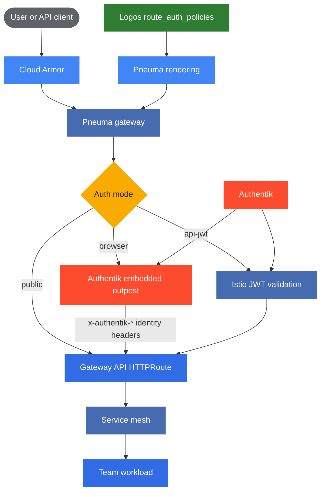

# Gateway Authentication

Pneuma enforces authentication and authorization for external application routes at the shared gateway. Teams request route-level intent through the Nomos Agent, which records it in Logos; Pneuma renders the required Istio and Authentik resources before traffic reaches a workload cluster.

:::info Consuming teams

This page is for Pneuma owners. To request a route and its authentication policy, see [Expose and Protect a Route](../../getting-started/expose-a-route.md).

:::

:::tip Architecture Decision Records

This page includes [Architecture Decision Records](#architecture-decision-records) documenting the key design decisions.

:::

## Architecture

Gateway auth runs on the Pneuma gateway data plane (`gateway-istio`). It combines Authentik browser-session enforcement, Istio JWT validation for API clients, and Envoy external authorization so application teams do not need to operate an ingress authentication stack.

Authentik is the platform identity provider. Its environment hostname (`authentik.<env>.osinfra.io`; production omits the environment segment) resolves to MCI, and each gateway zone exposes the same service directly at `<zone>.authentik.<env>.osinfra.io`. The `pt-pneuma` `authentik` and `authentik-config` workspaces deploy and configure it through `pt-arche-kubernetes-authentik`. Authentik stores persistent data in Cloud SQL PostgreSQL, and its embedded outpost provides the Envoy `ext_authz` endpoint for browser sessions.

Browser identity reaches workloads as gateway-controlled `x-authentik-*` headers, not a bearer JWT. The gateway owns that namespace, so a value supplied by an external client is never a trusted identity source.

## Components

| Component | Owner | Description |
|---|---|---|
| Logos `route_auth_policies` | Logos | Source of truth for route-level auth intent. Policies are keyed by an existing route name. |
| Authentik | Pneuma via Arche | Platform OIDC provider and identity layer deployed on the gateway clusters. |
| Embedded outpost | Pneuma via Arche | Forward-auth endpoint for browser sessions. Istio registers it as the `authentik` external authorization provider. |
| Authentik applications and policies | Pneuma via Arche | Per-host application and proxy provider, plus one browser-access policy per team shared by that team's hosts, generated from browser-route group and role requirements. |
| Istio `RequestAuthentication` | Pneuma | Validates bearer JWTs against the Authentik issuer and JWKS. |
| Istio `AuthorizationPolicy` | Pneuma | Sends browser requests to Authentik or enforces API JWT claims natively. |

## Request Flow

1. Cloud Armor evaluates edge security policy. Authentik's `/api/v3/` paths on its exact environment hostname permit `DELETE`, `PATCH`, and `PUT` through the method-enforcement check so browser administration works. Other WAF checks remain active, and Authentik still enforces authentication, permissions, and CSRF protection. Gateway identity-header stripping preserves the exact `X-authentik-CSRF` header needed for browser writes; other client-supplied `X-authentik-*` headers are removed before forward authentication.
2. TLS terminates at the shared gateway.
3. The route's auth mode determines enforcement:
   - `browser` sends the request to the Authentik embedded outpost, which validates the browser session and returns trusted `x-authentik-*` identity headers for the upstream request.
   - `api-jwt` has Istio validate the bearer JWT against the Authentik JWKS, then evaluates the validated principal and claims.
   - `public` skips auth enforcement.
4. Gateway API routes Authentik callbacks to the embedded outpost and application traffic to the team service.
5. Mesh mTLS and workload authorization protect traffic after it enters the service mesh.

:::warning Fail-closed by default

Enforced routes do not fail open. Configuration with an unknown or incomplete auth mode is rejected before deployment. If the browser authorization service is unavailable, the gateway denies the request.

:::

## Google Sign-In Configuration

Pneuma owners configure a separate Google OAuth **Web application** client for each environment. Set the Google Auth Platform audience to **Internal** in the platform's Google Workspace organization. Follow the [Authentik Google OAuth setup](https://docs.goauthentik.io/users-sources/sources/social-logins/google/cloud/) and register the exact authorized redirect URI, including the trailing slash:

| Environment | Authorized redirect URI |
|---|---|
| Sandbox | `https://authentik.sb.osinfra.io/source/oauth/callback/google/` |
| Non-production | `https://authentik.nonprod.osinfra.io/source/oauth/callback/google/` |
| Production | `https://authentik.osinfra.io/source/oauth/callback/google/` |

Set each non-sensitive `google_oauth_client_id` in the matching `pt-pneuma/regional/authentik-config/environments/{sandbox,non-production,production}.tfvars` file. Keep the client ID, secret, and callback URI paired with the same environment when rotating credentials.

The Google source is enabled only when both its client ID and secret are non-empty. Managed application groups require that source to be enabled. An Internal audience controls who can sign in with Google; it does not grant application access or replace group-based authorization.

The Google identity mapping classifies a user as internal only when Google verifies the email, its domain matches the Workspace `hd` claim, and that domain is in the configured internal-domain allowlist (`osinfra.io` for Pneuma). Other Google users remain external. Internal status enables the authentik user interface, not administrative permissions; only Pneuma's declared `authentik-admins` group receives global superuser access.

After changing identity mappings, reconcile the target environment and verify Google sign-in and administrator permissions. Existing accounts receive updated classification on their next Google sign-in.

Deploy Authentik and its gateway routes before applying Authentik Config, which calls the live management API. OAuth credentials do not fix an unavailable Authentik instance in an environment without clusters. Verify configuration with a real internal-user Google browser sign-in and the intended application's authorization checks once the environment is available.

## Browser Authorization

Pneuma renders one Authentik application and proxy provider per gateway host, with policy bindings for the declared `required_groups` and `required_roles`. API JWT routes evaluate the `groups` and `roles` token claims directly in Istio. Consumer-facing rules are in [Expose and Protect a Route](../../getting-started/expose-a-route.md#browser-routes).

:::caution Policies are scoped per host

authentik applications and bindings are scoped to a host, not a path. A host is evaluated against one shared team policy, so browser routes on one host must declare identical group and role requirements. The platform rejects conflicting requirements.

:::

### Team-owned application groups

Logos declares per-environment application access through [`authentik_groups`](../logos/team-topology.md#authentik-group-declarations). Group names carry the owning team key and preserve application branding, for example `pt-pneuma: agentgateway Admins`. Names contain spaces, so matching must compare whole names.

| Aspect | Behavior |
|---|---|
| Membership source | The authentik Google source mapping assigns membership from a verified OAuth email at enrollment and sign-in; configuration deployment reconciles already-verified users. No accounts or passwords are pre-provisioned. |
| Group type | Groups do not inherit ordinary team membership. Pneuma's `authentik-admins` grants global authentik superuser access; all other declared groups grant only their application-specific access. |
| Pending members | `pending_application_members` lists declared identities without verified enrollment. It is sensitive: inspect it only through approved state-access procedures, never in workflow logs or PR comments. An empty list does not prove authorization works. |
| Post-auth guard | The shared renderer creates a cluster-owned guard only when a browser route requires a managed group. It strips inbound identity headers, authenticates with `ext_authz`, and checks the current declared emails against a dedicated Google-established identity header. An ordinary email header or cached group claim cannot grant managed access. |
| Membership changes | Deploy Logos, then manually dispatch the Pneuma reconciliation workflows. |

## Verification

The platform `istio-test` route exposes public probes and a protected diagnostic. It uses `mode = "browser"` and `required_groups = ["all"]`, with the health and metadata paths in `public_paths`.

| Request | Expected result |
|---|---|
| `/istio-test/health` or `/istio-test/metadata/cluster-name`, no session | Application response, no redirect. A redirect means the public-path bypass is broken. |
| `/istio-test/auth`, no session | Redirect to Authentik |
| `/istio-test/auth`, signed in as a member of `all` | JSON with the trusted identity (`username`, `email`, `name`, `uid`, `groups`) plus troubleshooting context, described below |

The authenticated `/istio-test/auth` response also includes:

| Object | Fields |
|---|---|
| `authentik` | `application`, `provider`, `outpost`, `version`, `entitlements`, `googleEmail`: which Authentik application and outpost authorized the request |
| `request` | `host`, `forwardedHost`, `forwardedProto`, `forwardedFor`, `requestId`, `traceparent`, `peerIdentity` (the caller's SPIFFE ID when the gateway forwards `X-Forwarded-Client-Cert`), and `authentikHeaders` (the names, never the values, of the `x-authentik-*` headers received) |
| `workload` | `pod`, `namespace`, `version` |

Cluster, region, and zone details stay on the public `/istio-test/metadata/*` endpoints. The response never includes tokens, cookies, or the `Authorization` header.

### Application dashboard and policies

Authentik shows an application on a user's dashboard when the user passes its policy bindings and the application is not hidden. Every browser application uses `policy_engine_mode = "all"`, so the dashboard and the forward-auth check use the same decision.

- Each team gets one policy, named `<team-key>-browser-access` (for example `pt-pneuma-browser-access`), shared by every host the team owns. All browser routes in a team therefore must declare identical `required_groups` and `required_roles`. agentgateway has its own `agentgateway-browser-access` policy. Policy names are lowercase kebab-case; the Google source policy is `google-source-authentication-require-sso`. The local fixture uses `local-development-browser-access`.
- Authentik applications are per host. Each team's apex host has the visible "Istio" tile, which launches `https://<dns-zone>/istio-test/auth`. The zonal hosts (`<zone>.<dns-zone>`) are hidden with `meta_hide`, so teams see the same tiles regardless of region while every host stays protected.
- Only the paths that Istio sends to the outpost reach these policies. Public paths skip Authentik.

### Headers forwarded to workloads

The gateway forwards an explicit allow-list from the outpost: `x-authentik-username`, `-email`, `-name`, `-uid`, `-groups`, `-entitlements`, `-osinfra-google-email`, and `-meta-app`, `-meta-provider`, `-meta-outpost`, `-meta-version`. The user token (`x-authentik-jwt`) and its JWKS URL are never forwarded.

OAuth callbacks under `/outpost.goauthentik.io` route directly to the embedded outpost on every protected browser host.

### Local integration checks

For complex browser-auth or gateway changes, use `/platform-grouping:local-integration-testing`. Full verification requires real Google sign-in, authorized and denied requests, public-path bypasses, forged-header denial, and ambient mTLS. See [Module Development](../arche/module-development.md#optional-local-integration-tests) for the optional workflow and its cloud-parity limits.

## Operational Expectations

- Route-auth changes deploy through the normal Logos-to-Pneuma pipeline.
- Pneuma owns Authentik availability, Cloud SQL persistence, and gateway auth observability.
- Browser authorization depends on current Authentik group and role membership.

## Core Invariants

- Auth intent is declared in Logos, never in team-managed gateway resources.
- Enforced routes fail closed, and unauthenticated requests are denied before reaching a team backend.
- Public bypasses cannot expose an entire route (`/`, `/*`, or `*`).
- API JWTs are validated at the gateway before authorization.
- Browser identity reaches workloads only through gateway-controlled `x-authentik-*` headers after the session is authorized.

## Architecture Decision Records

### Centralized Gateway Authentication Enforcement

<table>
  <thead>
    <tr><th>Status</th><th>Date</th><th>Deciders</th></tr>
  </thead>
  <tbody>
    <tr><td>Accepted ✅</td><td>July 2026</td><td>Pneuma, Logos, Techne</td></tr>
  </tbody>
</table>

#### Context and Problem Statement

External team services need consistent authentication and authorization without every team operating its own ingress auth stack. If each team owned identity clients, forward-auth instances, Istio auth policies, and gateway resources directly, the platform would drift into inconsistent fail-open behavior and unclear ownership during incidents.

#### Decision

Centralize authn/authz at Pneuma gateway clusters. Logos remains the contract where teams declare route-auth intent; Pneuma consumes that contract and renders Authentik, the embedded-outpost ext_authz path, Istio JWT validation, and Istio authorization policy centrally. Arche packages the reusable Authentik module, and Techne provides the schema and Nomos authoring flow.

#### Alternatives Considered

- **Team-managed gateway auth resources** — Rejected. Direct Kubernetes ownership would bypass the reviewed Logos contract and make route isolation, fail-closed behavior, and incident ownership inconsistent.
- **Per-application forward-auth proxies** — Rejected. Duplicates auth infrastructure in every app, complicates upgrades, and does not protect requests before they enter workload clusters.
- **Application-only authorization** — Rejected. Leaves unauthenticated traffic to reach teams and makes centralized denial observability impossible.

#### Consequences

- Teams get a self-service auth contract without owning gateway internals.
- Pneuma is the single operational owner for gateway auth availability, denial behavior, and observability.
- Schema validation in Techne and PR review in Logos become part of the security boundary.
- Gateway auth outages deny enforced traffic instead of failing open.

### Per-Host Browser Group and Role Enforcement

<table>
  <thead>
    <tr><th>Status</th><th>Date</th><th>Deciders</th></tr>
  </thead>
  <tbody>
    <tr><td>Accepted ✅</td><td>September 2026</td><td>Pneuma, Arche</td></tr>
  </tbody>
</table>

#### Context and Problem Statement

`browser`-mode routes validated only that a user had an authenticated Authentik session — the declared `required_groups` and `required_roles` on a route's `route_auth_policies` had no enforcement path. Any authenticated user could reach a `browser` route regardless of group or role membership, because no Authentik application, provider, or policy binding existed to evaluate those claims for a specific host.

#### Decision

Pneuma's `authentik-config` workspace renders one Authentik application and proxy provider per gateway host plus policy bindings for the declared browser principals. Because the embedded outpost authorizes an authenticated session against that host-scoped application rather than re-evaluating application policies for every route request, all browser routes for a team must declare identical `required_groups` and `required_roles`. Logos and Pneuma validate this invariant and reject conflicting route policies instead of silently widening access.

Group membership provisioning is separate from host-policy enforcement; see [Team-owned application groups](#team-owned-application-groups) for the membership contract.

#### Alternatives Considered

- **Manual per-route Authentik configuration** — Rejected. Requires an operator to hand-configure an application, provider, and policy binding in the Authentik UI for every enforced route, which does not scale, is not reviewable through Logos, and is easy to forget or get wrong.
- **Path-aware Authentik application policies on one host** — Rejected. The embedded outpost reuses its authenticated session for subsequent requests, so an application policy evaluated during authorization is not a reliable per-request path enforcement point.
- **Multiple single-application providers for the same host** — Rejected. Authentik selects forward-auth applications by host, so same-host providers cannot reliably represent distinct route policies.
- **Enforcing groups/roles entirely in Istio via JWT claims** — Rejected. Authentik's browser flow issues a session, not a JWT with claims usable by Istio's native `AuthorizationPolicy`; enforcement has to happen at the Authentik layer for interactive sessions.

#### Consequences

- `browser` routes with `required_groups` / `required_roles` are enforced consistently at the shared host boundary.
- Teams cannot assign different browser group or role requirements to routes on the same gateway host; they must align the requirements or use another auth mode.
- Authorized browser identity is forwarded to workloads through trusted `x-authentik-*` headers rather than an application-facing JWT.
- Adding or changing browser requirements remains a Logos change, but validation prevents configurations that the host-scoped Authentik model cannot enforce safely.
